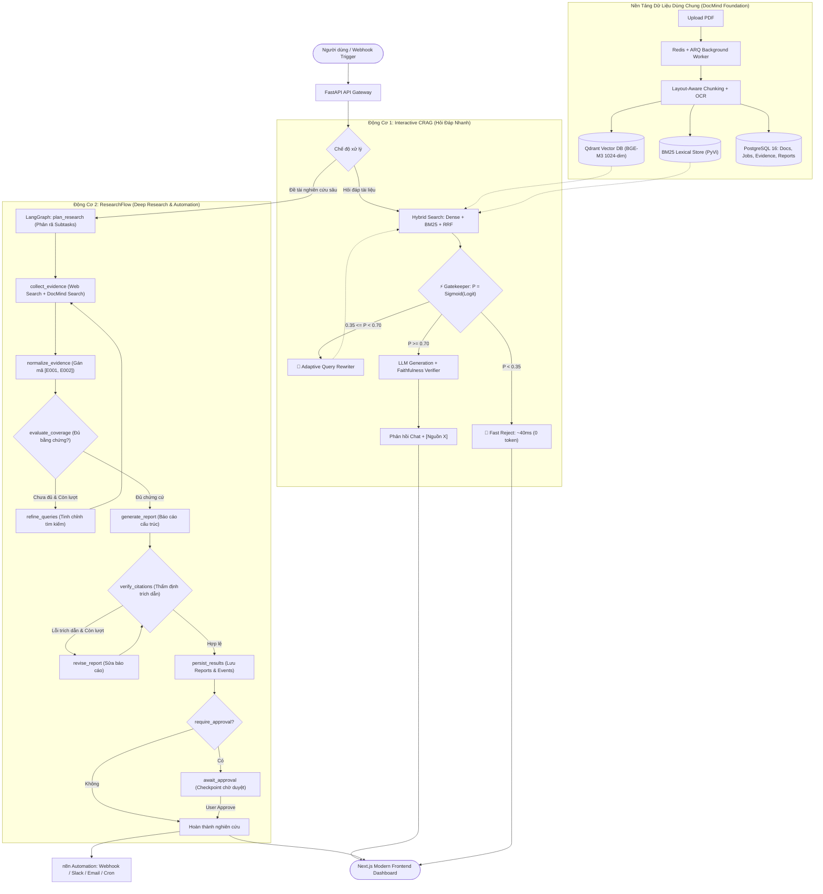

# ResearchMind AI — Enterprise Document Intelligence & Autonomous Deep Research Platform

<p align="center">
  
  
  
  
  
  
  
  
  
  
</p>

> **DocMind & ResearchFlow** là nền tảng trí tuệ tài liệu doanh nghiệp tích hợp 2 động cơ cốt lõi:
> 1. **DocMind (Interactive CRAG):** Động cơ hỏi đáp tức thì trên tài liệu nội bộ chuẩn Enterprise, sử dụng tìm kiếm lai (Hybrid Dense + Sparse BM25), bộ lọc xác suất biên (*Probability Gatekeeper*) chặn câu hỏi ngoài lề trong **< 40ms** (0 token LLM), và hậu kiểm trung thực (*Faithfulness Guardrail*).
> 2. **ResearchFlow (Deep Research & Workflow Automation):** Động cơ nghiên cứu chuyên sâu đa tác tử điều phối bằng **LangGraph**. Tự động phân rã đề tài, tổng hợp đa nguồn (Web + Kho PDF DocMind), đánh giá độ bao phủ chứng cứ (Coverage Loop), thẩm định trích dẫn từng câu (*Claim-level Evidence* `[E001, E002]`), và tự động hóa quy trình qua **n8n** (Webhook, Cron scheduled research, Human approval).

---

## ⚡ 6 Điểm Khác Biệt Cốt Lõi (Key Highlights)

| Tính Năng | Động Cơ | Bản Chất Kỹ Thuật & Giá Trị |
| :--- | :---: | :--- |
| **Probability Gatekeeper** | DocMind | Dùng Cross-Encoder tính $P = \text{Sigmoid}(\text{logit})$. Chặn câu hỏi lạc đề trong **~40ms**, tiêu thụ **0 token LLM**, cắt giảm **62.5% chi phí API**. |
| **SOTA Hybrid Retrieval** | DocMind | Kết hợp Dense Vector `BAAI/bge-m3` (1024-dim trên Qdrant) + Okapi BM25 phân đoạn tiếng Việt `PyVi` qua thuật toán Reciprocal Rank Fusion (RRF $k=60$). |
| **Post-Gen Faithfulness** | DocMind | Hậu kiểm 100% câu trả lời có trích dẫn `[Nguồn X]`, loại bỏ suy đoán vô căn cứ, nâng điểm Ragas Faithfulness lên **0.95**, ép tỷ lệ ảo giác xuống **< 0.6%**. |
| **Stateful Deep Research** | ResearchFlow | Điều phối bằng **LangGraph** dạng chu trình có trạng thái (`ResearchState`), kiểm soát giới hạn lặp (`bounded loops`), tự động mở rộng và tinh chỉnh truy vấn (`refine_queries`). |
| **Claim-Level Evidence Registry** | ResearchFlow | Chuẩn hóa bảng bằng chứng `[E001, E002]` gắn cứng với URL gốc hoặc số trang PDF. Thẩm định độc lập 3 tầng: *Tồn tại nguồn*, *Khớp metadata*, và *Mức độ chứng minh luận điểm*. |
| **Decoupled n8n Automation** | ResearchFlow | Tách biệt hoàn toàn: Agent tập trung lập luận; **n8n** xử lý gửi email/Slack báo cáo hoàn thành, kích hoạt quét tài liệu theo lịch cron, và hỗ trợ con người phê duyệt (Human-in-the-loop). |

---

## 🏗️ Kiến Trúc Hệ Thống Tổng Thể



---

## 📊 Kết Quả Thực Nghiệm & Bóc Tách (Ablation Benchmark)

### 1. Động cơ CRAG (1,000 Queries: In-domain, Ambiguous, Out-of-domain)
- **Tiết kiệm chi phí API:** Giảm **62.5%** tổng chi phí gọi LLM nhờ Gatekeeper chặn 100% câu hỏi ngoài lề trong **< 40ms**.
- **Độ trung thực (Ragas Faithfulness):** Đạt **0.95/1.0**, tỷ lệ ảo giác (Hallucination) giảm từ **42%** (Naive RAG) xuống **< 0.6%**.
- **Độ trễ trung bình:** ~1,924 ms cho câu hỏi chuẩn và ~40 ms cho câu hỏi bị từ chối nhanh.

### 2. Động cơ Deep Research (Bộ 50 Research Tasks chuẩn)
- **Tỷ lệ hợp lệ mã trích dẫn (Citation ID Validity):** **> 99%** (nhờ cơ chế giải mã `evidence_id` nội bộ thay vì để LLM tự sinh URL).
- **Mức độ bao phủ yêu cầu (Requirement Coverage):** Tăng vượt bậc nhờ vòng lặp tinh chỉnh truy vấn (`refine_queries`) khi bằng chứng ban đầu chưa đạt.
- **Khả năng phục hồi:** Tự động khôi phục luồng nghiên cứu thông qua persistent checkpointing khi tiến trình bị gián đoạn.

---

## 🔌 Danh Mục REST API Chính

| Nhóm API | Method | Endpoint | Mô Tả Chức Năng |
| :--- | :--- | :--- | :--- |
| **Documents** | `POST` | `/api/v1/documents/upload` | Nạp PDF, bóc tách cấu trúc, OCR đa tầng và chunking bất đồng bộ. |
| | `GET` | `/api/v1/documents` | Lấy danh sách tài liệu và trạng thái chỉ mục. |
| **Interactive Chat** | `POST` | `/api/v1/chat` | Hỏi đáp ngữ cảnh tài liệu qua CRAG (Gatekeeper, Rewriter, Verifier). |
| | `GET` | `/api/v1/chat/sessions` | Quản lý lịch sử phiên hội thoại. |
| **Deep Research** | `POST` | `/api/v1/research-jobs` | Khởi tạo job nghiên cứu sâu (topic, goal, max_iterations, approval). |
| | `GET` | `/api/v1/research-jobs/{job_id}` | Theo dõi trạng thái tiến trình LangGraph (node hiện tại, số vòng lặp). |
| | `GET` | `/api/v1/research-jobs/{job_id}/events` | Chi tiết timeline thực thi từng node (thời gian chạy, token, trạng thái). |
| | `POST` | `/api/v1/research-jobs/{job_id}/resume` | Tiếp tục thực thi job sau khi tạm dừng hoặc gặp sự cố. |
| | `POST` | `/api/v1/research-jobs/{job_id}/approval` | Phê duyệt hoặc yêu cầu chỉnh sửa báo cáo (Human-in-the-loop). |
| **Reports & Evidence** | `GET` | `/api/v1/reports/{report_id}` | Tải báo cáo nghiên cứu hoàn chỉnh (Markdown / Structured JSON). |
| | `GET` | `/api/v1/reports/{report_id}/citations` | Tra cứu chi tiết từng mã bằng chứng (`evidence_id` $\rightarrow$ snippet, URL, trang). |

---

## 📁 Cấu Trúc Thư Mục Dự Án

```text
AI_Document_Intelligence_System/
├── backend/
│   ├── app/
│   │   ├── api/routes/             # Endpoints: documents, chat, research, jobs, health
│   │   ├── core/                   # Cấu hình Pydantic settings & Langfuse tracing
│   │   ├── db/                     # Models: documents, chunks, research_jobs, evidence, reports
│   │   ├── documents/              # PDF Engine, Layout-aware chunker, OCR fallbacks
│   │   ├── rag/                    # CRAG: Gatekeeper, QueryRewriter, FaithfulnessVerifier
│   │   ├── research/               # [RESEARCHFLOW] LangGraph Orchestrator:
│   │   │   ├── graph/              # State, Nodes (Planner, Collector, Evaluator, Writer, Verifier), Routing
│   │   │   ├── tools/              # WebSearch (DuckDuckGo), WebFetch, DocMindRetriever
│   │   │   └── services/           # ResearchJobService, WebhookService (n8n dispatcher)
│   │   ├── retrieval/              # QdrantVectorStore, BM25 (PyVi), Cross-Encoder Reranker
│   │   └── workers/                # ARQ background queue & task workers
│   ├── labs/                       # Benchmark scripts (ablation_benchmark.py, 50 research tasks)
│   ├── tests/                      # Bộ kiểm thử Unit & Integration (37+ tests passed)
│   └── Dockerfile
├── frontend/                       # Next.js 16 App Router UI (Chat RAG + Deep Research Dashboard)
├── workflows/n8n/                  # Template workflow n8n (job_completed.json, scheduled_research.json)
├── raw_data/                       # Tập tài liệu bài báo khoa học arXiv mẫu
├── docker-compose.yml              # Khởi chạy toàn bộ: Postgres, Redis, Qdrant, Langfuse, n8n, Backend, Frontend
├── .env.example                    # File cấu hình mẫu
└── README.MD                       # Tài liệu tổng quan hệ thống
```

---

## 🚀 Hướng Dẫn Khởi Chạy Nhanh

### 1. Khởi chạy toàn bộ hệ thống bằng Docker Compose (Khuyến nghị)

```bash
# 1. Sao chép biến môi trường và điền GEMINI_API_KEY
cp .env.example .env

# 2. Khởi chạy toàn bộ các dịch vụ nền tảng
docker compose up --build -d
```

Sau khi khởi động thành công:
- 🌐 **Giao diện người dùng (Frontend):** `http://localhost:3000`
- 📚 **Swagger API Docs (Backend):** `http://localhost:8000/docs`
- 🔄 **n8n Workflow Automation:** `http://localhost:5678`
- 🔭 **Langfuse Observability:** `http://localhost:3001`
- 📊 **Qdrant Vector Dashboard:** `http://localhost:6333/dashboard`

### 2. Chạy Kiểm Thử & Benchmark

```powershell
# Chạy toàn bộ Unit & API Tests
.\backend\.env\Scripts\python.exe -m pytest backend/tests/unit -v

# Chạy báo cáo đo lường bóc tách CRAG (1,000 queries)
.\backend\.env\Scripts\python.exe backend\labs\ablation_benchmark.py
```

---

## 📜 Giấy Phép & Đóng Góp

Dự án được phân phối dưới giấy phép **MIT License**. Mọi thắc mắc hoặc yêu cầu tích hợp xin vui lòng tạo Issue hoặc Pull Request.
